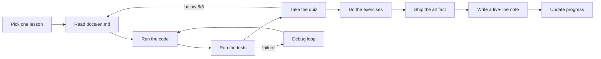

# Course Guide: AI Engineering from Scratch

> A beginner's field manual for this machine. Read this when you do not know what to do next, or when something breaks.

**Machine:** Windows, PowerShell 7, all toolchains installed on `F:`
**Repository:** `F:\Coding\ai_eng`
**Virtual environment:** `F:\Coding\ai_eng\.venv`
**Toolchains:** `F:\Coding\.toolchains`
**Repo commit at setup:** `f7aadc1d` (2026-10-22)
**Git remotes:** `origin` = your fork, `upstream` = the course
**Setup verified:** 2026-10-22, `verify.py --route beginner --show-later` passes every required check

This is a personal study guide, not part of the upstream curriculum. Keep it with your notes; it is safe to delete or move.

---

## Contents

1. [Start here](#1-start-here)
2. [How the course is built](#2-how-the-course-is-built)
3. [The lesson loop](#3-the-lesson-loop)
4. [Commands you will use](#4-commands-you-will-use)
5. [How to finish a phase](#5-how-to-finish-a-phase)
6. [Routes and learning paths](#6-routes-and-learning-paths)
7. [Progress tracking and artifacts](#7-progress-tracking-and-artifacts)
8. [Troubleshooting: when you are stuck](#8-troubleshooting-when-you-are-stuck)
9. [Environment reference](#9-environment-reference)
10. [Study plans](#10-study-plans)
11. [Lesson-specific survival notes](#11-lesson-specific-survival-notes)
12. [Help request template](#12-help-request-template)

---

## 1. Start here

Open PowerShell and run this exact sequence:

```powershell
cd "F:\Coding\ai_eng"
.\.venv\Scripts\Activate.ps1
python3 phases\00-setup-and-tooling\01-dev-environment\code\verify.py --route beginner --show-later
```

You should see `Ready to start Beginner course.` If not, jump to [Troubleshooting](#8-troubleshooting-when-you-are-stuck).

Then open your first real lesson:

```powershell
notepad phases\01-math-foundations\01-linear-algebra-intuition\docs\en.md
python3 phases\01-math-foundations\01-linear-algebra-intuition\code\vectors.py
```

Three habits keep this course manageable:

1. **One lesson per session.** Do not "read ahead" by skimming five lessons.
2. **Run the code.** A lesson is not complete until you have seen its output in your own terminal.
3. **Keep evidence.** Save the command, the output, the test result, and a five-line note. Future-you will need them.

If PowerShell blocks activation:

```powershell
Set-ExecutionPolicy -Scope Process -ExecutionPolicy Bypass
.\.venv\Scripts\Activate.ps1
```

### Your first seven days

The environment check ends with the exact next command:

```text
Next: python3 phases/01-math-foundations/01-linear-algebra-intuition/code/vectors.py
```

A calm first week looks like this:

| Day | Work | Why |
|---|---|---|
| 1 | Phase 0 Lesson 01, run the verifier | You are here |
| 2 | Phase 0 Lesson 02, Git and Collaboration | You need version control before you break things |
| 3 | Phase 0 Lesson 06, Python Environments | Understand the venv you are using |
| 4 | Phase 1 Lesson 01, Linear Algebra Intuition | First real lesson |
| 5 | Phase 1 Lesson 02, Vectors and Matrices | The vocabulary for everything after |
| 6 | Exercise day: redo the week's code without notes | Retrieval beats rereading |
| 7 | Review, update `PROGRESS.md`, plan next week | Keeps the habit alive |

Do not start Phase 2 in week one. The foundation is the point.

---

## 2. How the course is built

The curriculum is 20 phases and 542 lessons. Each lesson is a folder:

```text
phases/
  01-math-foundations/
    01-linear-algebra-intuition/
      docs/en.md      lesson explainer
      code/           runnable implementation
      code/tests/     optional unit tests
      quiz.json       6 self-test questions
      outputs/        reusable artifact shipped by the lesson
```

### Lesson anatomy

| Part | What it is | What you do with it |
|---|---|---|
| `docs/en.md` | The lesson: problem, concept, build steps, use-it, ship-it, exercises | Read actively, then run the commands |
| `code/` | The implementation in Python, TypeScript, Rust, or Julia | Run it, modify it in a copy, break it on purpose |
| `code/tests/` | Unit tests for the implementation | Run them; read a failing test before changing code |
| `quiz.json` | 1 pre, 3 check, 2 post questions | Answer before looking at the key |
| `outputs/` | A prompt, skill, agent, or tool the lesson ships | Copy it into your own artifact folder and use it |

The website is a renderer of the same files. Use it for comfortable reading and the interactive quiz. Use the local files for running code. When the two appear to disagree, the local repository at your current commit is the source of truth.

### Lesson front matter

Every lesson begins with a short block:

```markdown
**Type:** Learn | Build | Reference
**Languages:** Python, TypeScript, Rust, Julia
**Prerequisites:** Phase 0, Lesson 01
**Time:** ~45 minutes
```

- **Learn** lessons are mostly reading and judgment. They may have no code.
- **Build** lessons have a runnable implementation and usually tests.
- **Reference** lessons are lookup material. Do not read them linearly.

`Prerequisites` is not decoration. If a lesson assumes a previous one, do the previous one first.

### The 20 phases

| Phase | Lessons | Roadmap time | What it gives you |
|---|---:|---:|---|
| 0. Setup and Tooling | 13 | ~16 h | A working machine, Git, editors, terminals, data handling |
| 1. Math Foundations | 22 | ~23 h | Vectors, calculus, probability, optimization, SVD, tensors |
| 2. ML Fundamentals | 21 | ~26 h | Regression, trees, SVM, clustering, evaluation, pipelines |
| 3. Deep Learning Core | 13 | ~15 h | Backprop, optimizers, a mini framework, PyTorch and JAX |
| 4. Computer Vision | 28 | ~27 h | CNNs, detection, segmentation, diffusion, ViT, video, 3D |
| 5. NLP Foundations to Advanced | 29 | ~30 h | Tokenization, embeddings, attention, retrieval, summarization |
| 6. Speech and Audio | 17 | ~18 h | Audio features, ASR, TTS, speech models |
| 7. Transformers Deep Dive | 16 | ~14 h | Attention internals and transformer variants |
| 8. Generative AI | 15 | ~14 h | VAEs, GANs, diffusion, flow models |
| 9. Reinforcement Learning | 12 | ~13 h | MDPs, Q-learning, policy gradients, RLHF basics |
| 10. LLMs from Scratch | 24 | ~26 h | Tokenizer, attention, training loop, a small GPT |
| 11. LLM Engineering | 17 | ~19 h | Prompting, structured output, RAG, evaluation, cost |
| 12. Multimodal AI | 25 | ~65 h | Vision-language, audio-language, document and video models |
| 13. Tools and Protocols | 45 | ~76 h | Tool schemas, function calling, MCP, agent SDKs |
| 14. Agent Engineering | 54 | ~55 h | Agent loop, memory, planning, verification, failure modes |
| 15. Autonomous Systems | 22 | ~20 h | Long-running agents, sandboxes, oversight, recovery |
| 16. Multi-Agent and Swarms | 25 | ~28 h | Delegation, coordination, negotiation, orchestration |
| 17. Infrastructure and Production | 29 | ~34 h | Serving, observability, security, SRE, release gates |
| 18. Ethics, Safety and Alignment | 30 | ~31 h | Threat models, policy, evaluation, governance |
| 19. Capstone Projects | 85 | project time | End-to-end systems you can show someone |

The roadmap's `~332 hours` is guided lesson time. Capstones add far more. Treat the numbers as a lower bound, not a deadline.

---

## 3. The lesson loop

Every lesson follows the same loop. Use it until it becomes automatic.



### Step 1: Preview the lesson (5 minutes)

Read only the front matter and the Learning Objectives. Ask:

- What can I do after this lesson that I could not do before?
- What does it assume I already know?
- How long should it take?

Run the pre-question from `quiz.json` before reading. Being wrong now makes the lesson stick.

### Step 2: Read for understanding (15-25 minutes)

Read `The Problem` and `The Concept` before touching code. Close the file and explain the idea out loud in one paragraph. If you cannot, reread the section. Do not highlight; summarize.

### Step 3: Build it (20-40 minutes)

Type the code from `Build It` into your own file. Do not copy-paste. Predict the output before running. When it differs, investigate before moving on.

Run the lesson's canonical file first, unmodified:

```powershell
python3 <lesson-folder>\code\main.py
```

If the lesson ships `main.ts`, `main.rs`, or `main.jl`, run the matching command from [Commands](#4-commands-you-will-use).

### Step 4: Use it (10 minutes)

The `Use It` section shows the production library that does the same thing. Compare it to your from-scratch version. Name one thing the library hides and one thing it makes easier.

### Step 5: Run the tests (5-10 minutes)

From the lesson folder:

```powershell
cd phases\02-ml-fundamentals\19-ml-system-design
python3 -m unittest discover -s code\tests -v
cd ..\..\..
```

A passing test is evidence. A failing test is a precise question. Read the assertion before changing code.

### Step 6: Take the quiz (10 minutes)

`quiz.json` has exactly six questions in three stages:

| Stage | Count | Purpose |
|---|---:|---|
| `pre` | 1 | Surface a misconception before you start |
| `check` | 3 | Test the core concept and the code |
| `post` | 2 | Transfer the idea to a new situation |

Answer all six in a text file, then check the `correct` index and `explanation`. Target 5/6. If you score below 5, reread the sections tied to the misses before continuing.

Do not peek at the answer key first. Recognition is not recall.

### Step 7: Do the exercises (15-30 minutes)

The `Exercises` section ends with `Hints`. Do at least one easy and one medium exercise. Copy the lesson code into your artifact folder before modifying it:

```powershell
mkdir "F:\Coding\ai_eng\learning-artifacts\phase-01\lesson-01"
copy phases\01-math-foundations\01-linear-algebra-intuition\code\vectors.py "F:\Coding\ai_eng\learning-artifacts\phase-01\lesson-01\"
```

Never "fix" the original lesson to make an exercise pass. Keep the reference implementation clean.

### Step 8: Ship the artifact (5 minutes)

`outputs/` is the reusable part of the lesson: a prompt, skill, agent, MCP server, or tool. Copy it to your artifact folder and fill in the blanks for your own use. If the lesson has no artifact, write a short cheat sheet instead.

### Step 9: Write a five-line note (5 minutes)

Use this template in `F:\Coding\ai_eng\PROGRESS.md` or a notes app:

```markdown
## Phase 01 / Lesson 01 - Linear Algebra Intuition (2026-10-22)
- Command: python3 phases/01-math-foundations/01-linear-algebra-intuition/code/vectors.py
- Evidence: output shows cosine similarity 0.9746 and matrix-vector layer output
- I can explain: dot product, projection, rank, why attention uses matrix multiplication
- Still fuzzy: Gram-Schmidt numerical stability
- Artifact: copied prompt-linear-alg.md to learning-artifacts/phase-01/lesson-01/
```

### Step 10: Update progress (1 minute)

Mark the lesson in your own tracker. Do not edit the upstream `ROADMAP.md`; it belongs to the repository and will conflict on updates.

### A lesson is done when all of these are true

- [ ] I ran the canonical code and saw its output.
- [ ] I ran the tests, or the lesson has none and I verified the output by hand.
- [ ] I scored at least 5/6 on the quiz.
- [ ] I completed at least one exercise without copying the answer.
- [ ] I saved the artifact and wrote a note with the command and result.
- [ ] I can explain the lesson's main idea in two minutes without notes.

If you cannot check all six, you have not finished. That is fine. Leave it marked "in progress" and come back.

---

## 4. Commands you will use

Run every command from the repository root unless the lesson says otherwise:

```powershell
cd "F:\Coding\ai_eng"
.\.venv\Scripts\Activate.ps1
```

Your prompt should show `(.venv)`. Check the interpreter when in doubt:

```powershell
python3 -c "import sys; print(sys.executable); print(sys.version)"
```

The path must contain `.venv\Scripts\python3.exe` or `.venv\Scripts\python.exe`.

### Python lessons

```powershell
python3 phases\01-math-foundations\01-linear-algebra-intuition\code\vectors.py
```

### Python tests

Run from the lesson folder:

```powershell
cd phases\02-ml-fundamentals\19-ml-system-design
python3 -m unittest discover -s code\tests -v
```

If tests sit directly in `code/`:

```powershell
python3 -m unittest discover -s code -p "test_*.py" -v
```

### TypeScript lessons

```powershell
npx tsx phases\11-llm-engineering\01-prompt-engineering\code\main.ts
```

If a lesson has `*.test.ts` files, run the exact command in its docs. A common form is:

```powershell
npx tsx --test path\to\file.test.ts
```

First run of `npx tsx` may download the runner. That is normal. The cache lives on `F:`.

### Rust lessons

```powershell
rustc --edition 2021 phases\00-setup-and-tooling\01-dev-environment\code\main.rs -o lesson.exe
.\lesson.exe
```

If the lesson has a `Cargo.toml`:

```powershell
cargo run --manifest-path path\to\Cargo.toml
```

### Julia lessons

```powershell
julia phases\01-math-foundations\01-linear-algebra-intuition\code\vectors.jl
```

### Jupyter

```powershell
python3 -m jupyter lab
```

Launch it from the repository root with the venv active. If the kernel is missing, register the venv kernel once:

```powershell
python3 -m ipykernel install --sys-prefix --name ai-course --display-name "Python (AI course)"
```

`--sys-prefix` keeps the kernel under `.venv` on `F:`, not on `C:`.

### Run a whole phase's tests

```powershell
python3 scripts\run_lesson_tests.py --phase 01-math-foundations
```

The runner skips lessons whose optional dependency is not installed. That is a signal, not a failure. Install the dependency only when you reach that lesson.

### Syntax-check a phase without running it

```powershell
python3 scripts\lesson_run.py --phase 1
```

### Environment preflight by route

```powershell
python3 phases\00-setup-and-tooling\01-dev-environment\code\verify.py --route beginner --show-later
python3 phases\00-setup-and-tooling\01-dev-environment\code\verify.py --route ml-foundations
python3 phases\00-setup-and-tooling\01-dev-environment\code\verify.py --route llm-engineering
python3 phases\00-setup-and-tooling\01-dev-environment\code\verify.py --route agents
python3 phases\00-setup-and-tooling\01-dev-environment\code\verify.py --route mcp
python3 phases\00-setup-and-tooling\01-dev-environment\code\verify.py --route agent-skills
python3 phases\00-setup-and-tooling\01-dev-environment\code\verify.py --route certification
```

### Install packages

Use `uv`, not global pip:

```powershell
uv pip install numpy matplotlib
uv pip list
```

Install the full course requirements only when you need them. They are heavy:

```powershell
uv pip install -r requirements.txt
```

For a CPU-only PyTorch install, as on this machine:

```powershell
uv pip install torch torchvision torchaudio --index-url https://download.pytorch.org/whl/cpu
```

### Everyday Git checks

```powershell
git status
git diff
git log --oneline -5
```

Commit your notes and artifacts in this fork. Do not edit the lesson files to make an exercise pass; copy an experiment into `learning-artifacts\` instead. Keep `origin` for your work and pull course updates from `upstream`.

---

## 5. How to finish a phase

A phase is not finished when the last page is read. It is finished when you can use the phase without the lesson open.

### Phase gate checklist

- [ ] Every required lesson is either complete or explicitly deferred with a reason.
- [ ] Every Build lesson ran at least once and its tests passed or were explained.
- [ ] Quiz average across the phase is at least 5/6.
- [ ] You wrote one page of notes per lesson.
- [ ] You can explain the phase in five minutes without notes.
- [ ] You built one small thing that combines at least three lessons.
- [ ] You added the phase's new terms to your own glossary.
- [ ] You updated `PROGRESS.md`.

### Mini-projects by phase

Use these when a phase feels like disconnected facts:

| Phase | Mini-project |
|---|---|
| 0 | In a disposable practice repo or your own fork, make a branch, commit a change, and open a pull request |
| 1 | Implement a vector and matrix library with tests, then PCA from scratch |
| 2 | Train and evaluate linear and logistic regression on a real tabular dataset |
| 3 | Build an MLP from scratch, then reproduce it in PyTorch with the same weights |
| 4 | Train a small CNN and inspect its confusion matrix |
| 5 | Build a tokenizer and a text classifier from scratch |
| 7 | Implement scaled dot-product attention and a transformer block |
| 10 | Train a tiny GPT on a small text file and sample from it |
| 11 | Build a prompt plus an evaluation harness with pass and fail cases |
| 13 | Design a tool schema and call it through a mock MCP server |
| 14 | Implement an agent loop with a step limit, tool allowlist, and trace |
| 17 | Serve one model endpoint with health checks, logs, and a rollback plan |

### If a phase is too hard

1. Identify the first lesson where you got lost.
2. Reread its prerequisites and run their code.
3. Do the phase's earlier mini-project.
4. Ask one specific question with the evidence from [Help request template](#12-help-request-template).
5. If the next lesson does not depend on the blocked one, mark it `blocked` and move on. Return within a week.

Do not silently skip. A skipped prerequisite becomes three confusing lessons later.

---

## 6. Routes and learning paths

There are two ways to move through the material. They are compatible.

### Path A: The full beginner sequence

Use the phase order. This is the default the preflight calls `beginner`:

```text
Phase 0 -> Phase 1 -> Phase 2 -> Phase 3 -> Phase 4 / 5 / 10 / 11 -> Phase 13 / 14 -> Phase 17 -> Phase 19
```

- Phases 0-3 are the foundation. Do not skip them.
- Phases 4-12 are domains. Pick the one your goal needs.
- Phases 13-17 are engineering and production. Do these before calling yourself job-ready.
- Phase 18 is judgment. Do not skip it if you plan to ship to users.
- Phase 19 is the capstone. Scope it down until it runs end to end.

### Path B: A site learning path (an overlay)

The URL that started this setup uses `learningPath=software-engineering-fundamentals`. That path is a 13-lesson overlay, not a replacement for the phases. Complete the prerequisites each lesson names, then follow this order:

| Order | Lesson | Path |
|---:|---|---|
| 1 | Dev Environment | `phases/00-setup-and-tooling/01-dev-environment` |
| 2 | Git and Collaboration | `phases/00-setup-and-tooling/02-git-and-collaboration` |
| 3 | Python Environments | `phases/00-setup-and-tooling/06-python-environments` |
| 4 | Docker for AI | `phases/00-setup-and-tooling/07-docker-for-ai` |
| 5 | Data Management | `phases/00-setup-and-tooling/09-data-management` |
| 6 | Terminal and Shell | `phases/00-setup-and-tooling/10-terminal-and-shell` |
| 7 | Debugging and Profiling | `phases/00-setup-and-tooling/12-debugging-and-profiling` |
| 8 | The Tool Interface | `phases/13-tools-and-protocols/01-the-tool-interface` |
| 9 | Tool Schema Design | `phases/13-tools-and-protocols/05-tool-schema-design` |
| 10 | Verification Gates | `phases/14-agent-engineering/38-verification-gates` |
| 11 | Shadow, Canary, Progressive | `phases/17-infrastructure-and-production/20-shadow-canary-progressive` |
| 12 | Security and Secrets Audit | `phases/17-infrastructure-and-production/25-security-secrets-audit` |
| 13 | SRE for AI | `phases/17-infrastructure-and-production/23-sre-for-ai` |

This path assumes you can already program. If you are new, finish Phases 1-3 first, then take this overlay.

Other routes and their first command:

```powershell
python3 phases\00-setup-and-tooling\01-dev-environment\code\verify.py --route ml-foundations
python3 phases\00-setup-and-tooling\01-dev-environment\code\verify.py --route llm-engineering
python3 phases\00-setup-and-tooling\01-dev-environment\code\verify.py --route agents
python3 phases\00-setup-and-tooling\01-dev-environment\code\verify.py --route mcp
python3 phases\00-setup-and-tooling\01-dev-environment\code\verify.py --route agent-skills
python3 phases\00-setup-and-tooling\01-dev-environment\code\verify.py --route certification
```

### Which route should you pick?

| Goal | Route |
|---|---|
| I am new to programming and AI | Phases 0-3, then 4 or 5, then 11, 13, 14, 19 |
| I know Python, new to ML | Phase 1, 2, 3, 10, 11 |
| I want to build LLM applications | Phase 11, then 13, 14, 17 |
| I want to build agents | Phase 13, 14, 15, 16 |
| I want production and reliability | Phase 0, 13, 14, 17, 18 |
| I want the shortest job-ready foundation | 0, 1, 2, 3, 11, 13, 14, 17, one capstone |

The website's path is a recommendation, not a law. Prerequisites are the law.

---

## 7. Progress tracking and artifacts

Personal work lives inside your fork. The course upstream never tracks these paths, so course updates do not conflict with your notes:

```text
F:\Coding\ai_eng\
  PROGRESS.md
  COURSE-GUIDE.md
  learning-artifacts\
    phase-01\
      lesson-01\
    experiments\
```

Create the folders once:

```powershell
mkdir "F:\Coding\ai_eng\learning-artifacts\experiments" -Force
```

### `PROGRESS.md` template

```markdown
# My Progress

| Phase | Lesson | Date | Code ran | Tests | Quiz | Artifact | Note |
|---|---|---|---:|---|---|---|
| 00 | 01 Dev Environment | 2026-10-22 | yes | n/a | 6/6 | prompt-env-check | verified all tools |
| 00 | 02 Git and Collaboration |  |  |  |  |  |  |
| 01 | 01 Linear Algebra Intuition |  |  |  |  |  |  |
```

### Note template

````markdown
## Phase NN / Lesson MM - Title (YYYY-MM-DD)

**Goal in one sentence:**

**Command I ran:**
```text
...
```

**Output or evidence:**
```text
...
```

**What I can explain without notes:**

**What is still fuzzy:**

**Artifact and where I saved it:**

**One thing I would change if I built it again:**
````

Save each lesson note as `F:\Coding\ai_eng\learning-artifacts\phase-NN\lesson-MM\notes.md`. Save runnable experiments under `learning-artifacts\experiments\`.

### Git strategy

- `origin` is your fork: `https://github.com/mutassimalzeem/ai_eng.git`.
- `upstream` is the course: `https://github.com/rohitg00/ai-engineering-from-scratch.git`.
- Commit your notes and artifacts on `main` (or a `study` branch if you prefer).
- Pull course updates from `upstream`, then merge them:

```powershell
cd "F:\Coding\ai_eng"
git status
git fetch upstream
git merge upstream/main
```

- Push your work:

```powershell
git push origin main
```

- If you edited a lesson file and want the upstream version back:

```powershell
git checkout upstream/main -- phases\path\to\lesson
```

Your own work lives in `PROGRESS.md`, `COURSE-GUIDE.md`, and `learning-artifacts\`, none of which exist upstream, so this is safe.

---

## 8. Troubleshooting: when you are stuck

### The universal 30-minute protocol

1. **Stop.** Do not change five things at once.
2. **Read the last 15 lines of the error.** The cause is usually there, not in the first line.
3. **Confirm where you are.** Most "file not found" and "module not found" errors are a wrong directory.
4. **Confirm which Python you are using.** If it is not `.venv`, activate it.
5. **Reproduce with the exact command from the lesson.** Do not improvise flags.
6. **Reduce the problem.** Run only the failing import, only the failing function, only one test.
7. **Search with evidence.** Include the command, the full error, the file path, and your versions.
8. **Timebox to 30 minutes.** If still blocked, write down what you tried, mark the lesson `blocked`, and move to an independent lesson. Return the next day.

### Copy-paste diagnostic block

Run this with the venv active and paste the output when asking for help:

```powershell
Get-Location
Get-Command python3 | Select-Object Source
python3 -c "import sys; print(sys.executable); print(sys.version)"
python3 -c "import numpy, torch; print('numpy', numpy.__version__, 'torch', torch.__version__)"
python3 phases\00-setup-and-tooling\01-dev-environment\code\verify.py --route beginner --show-later
git status --short
```

### Symptom, cause, fix

| Symptom | Likely cause | Fix |
|---|---|---|
| `python3` opens Microsoft Store | Windows App Execution Alias is shadowing the real Python | Activate the venv, or call `.venv\Scripts\python3.exe` directly. Run `where.exe python3` to see the order |
| `Activate.ps1 cannot be loaded because running scripts is disabled` | PowerShell execution policy | `Set-ExecutionPolicy -Scope Process -ExecutionPolicy Bypass` then activate |
| `ModuleNotFoundError: No module named 'numpy'` | Wrong interpreter, usually the system Python | Activate `.venv`; confirm with the diagnostic block; install with `uv pip install numpy` |
| `UnicodeEncodeError: 'charmap' codec can't encode character` | Windows console is using cp1252 | `$env:PYTHONUTF8='1'` for this session. It is already persistent; open a new terminal |
| `ModuleNotFoundError: No module named 'main'` during tests | Tests run from the wrong directory | `cd` into the lesson folder, then `python3 -m unittest discover -s code\tests -v` |
| `FileNotFoundError` for a data file | Wrong working directory or missing download | Use the command and directory in the lesson. Do not rewrite the path |
| `uv: command not found` | Shell has not picked up the new user PATH | Open a new terminal, or run `F:\Coding\.toolchains\uv\uv.exe --version` |
| `rustc could not choose a version ... no default` | `RUSTUP_HOME` is missing in that shell | Open a new terminal, or set `$env:RUSTUP_HOME='F:\Coding\.toolchains\rustup'`; then `rustup default stable-x86_64-pc-windows-gnu` |
| Rust `link.exe not found` or `LINK : fatal error` | Rust is using the MSVC target without Visual Studio Build Tools | `rustup default stable-x86_64-pc-windows-gnu`; confirm `F:\Coding\.toolchains\mingw\mingw64\bin` is on PATH |
| `julia: command not found` | New PATH not loaded | Open a new terminal, or run `F:\Coding\.toolchains\julia\julia-1.13.2\bin\julia.exe` |
| Julia creates `C:\Users\hp\.julia` | `JULIA_DEPOT_PATH` is missing in that shell | Set it to `F:\Coding\.toolchains\julia-depot`, delete the C folder, reopen the terminal |
| `npx tsx` hangs on first run | It is downloading the runner | Wait once; later runs are local. Check the network if it stalls |
| `npm ERR! EACCES` or permission denied | A global install is targeting a protected directory | Do not run as administrator. Use `pnpm`, or install locally with `npx` |
| `docker: command not found` in Phase 0 Lesson 07 | Docker Desktop is not installed | This lesson is optional for the beginner route. Install Docker Desktop with its disk image on `F:`, or defer the lesson |
| `401 Unauthorized` or `invalid api key` | Missing or wrong API key | Phase 0 Lesson 04. Put keys in a local `.env`, never in code, never in Git |
| `429 Too Many Requests` | Rate limit or exhausted quota | Wait, reduce calls, cache results, or use a local model |
| `SSLCertVerifyError` or proxy errors | Corporate TLS inspection | Set `HTTPS_PROXY` and `REQUESTS_CA_BUNDLE` for the session, or use another network |
| `Address already in use` | A previous server or notebook still holds the port | Find and stop it: `Get-NetTCPConnection -LocalPort 8000` then `Stop-Process -Id <pid>` |
| `KeyboardInterrupt` or a long hang | Training run, server, or an interactive prompt | `Ctrl+C`. Use a smaller sample or the lesson's fast flag |
| `PermissionError` writing a cache | A tool is using a protected directory | Point its cache env var to `F:`. Do not run as administrator |
| `fatal: dubious ownership in repository` | The folder is owned by a different Windows account | `git config --global --add safe.directory "F:/Coding/ai_eng"` |
| `error: Your local changes would be overwritten` | You edited lesson files | Move your experiment to `learning-artifacts`, then `git checkout -- <path>` |
| `fatal: not a git repository` | Wrong folder | `cd "F:\Coding\ai_eng"` |
| `The filename or extension is too long` | Deep `node_modules` paths | `git config --global core.longpaths true`; keep the repo near the drive root |
| `No space left on device` on `C:` | A tool ignored the environment variables | Set `TEMP`, `TMP`, and the tool's cache variable in the same shell; restart the app |
| Jupyter starts but the kernel dies | The kernel is from a different Python | Launch from the venv; register with `python3 -m ipykernel install --sys-prefix` |
| Notebook imports fail but scripts work | Notebook is using the base kernel | Select the `Python (AI course)` kernel, or run `python3 -m jupyter lab` from the activated venv |

### Decode the error type

| Error | Usually means | First move |
|---|---|---|
| `ModuleNotFoundError` | Package missing or wrong environment | Confirm `sys.executable`, then install with `uv pip` |
| `ImportError: DLL load failed` | Broken wheel or architecture mismatch | Reinstall the package in the venv; do not mix 32-bit and 64-bit |
| `FileNotFoundError` | Wrong directory or missing data | `Get-Location`; read the lesson's command again |
| `AssertionError` | The test expected different behavior | Read the test; compare the expected and actual values |
| `KeyError` | API or data schema changed | Print the available keys before indexing |
| `ValueError: shapes ... not aligned` | Matrix dimensions do not match | Print both shapes; check the order of multiplication |
| `RuntimeError: mat1 and mat2 shapes cannot be multiplied` | Linear layer input size is wrong | Print the input shape; fix the layer's `in_features` |
| `CUDA out of memory` | Batch or model too large for the GPU | Reduce batch size or sequence length; use CPU or Colab |
| `HTTP 4xx` | Request, key, or quota problem | Read the response body; it usually names the field |
| `HTTP 5xx` | Provider-side failure | Retry with backoff; check the provider status page |

### When the lesson itself looks broken

1. Restore the original file: `git checkout -- phases\path\to\lesson`.
2. Run the exact command from `docs/en.md` on the clean copy.
3. Check `CHANGELOG.md` and the repository issues.
4. Update the clone: `git pull --ff-only`.
5. If it still fails, record the commit (`git rev-parse --short HEAD`), the command, and the error. Mark the lesson `blocked` and move to an independent one.

Do not spend a week fighting a broken lesson. The curriculum is large enough to make progress elsewhere while you wait for an upstream fix.

### If you are stuck on the environment, not the lesson

Run the preflight first. It names the failing layer and gives the corrective command:

```powershell
python3 phases\00-setup-and-tooling\01-dev-environment\code\verify.py --route beginner --show-later
```

If a check is `LATER`, it is not blocking your route. Install that tool when a lesson asks for it.

---

## 9. Environment reference

### Paths on this machine

| Purpose | Path |
|---|---|
| Course repository | `F:\Coding\ai_eng` |
| Git origin (your fork) | `https://github.com/mutassimalzeem/ai_eng.git` |
| Git upstream (the course) | `https://github.com/rohitg00/ai-engineering-from-scratch.git` |
| Python virtual environment | `F:\Coding\ai_eng\.venv` |
| uv executable | `F:\Coding\.toolchains\uv\uv.exe` |
| uv cache | `F:\Coding\.toolchains\cache\uv` |
| Python 3.12.15 | `F:\Coding\.toolchains\python\cpython-3.12.15-windows-x86_64-none` |
| Rust toolchains | `F:\Coding\.toolchains\rustup` |
| Cargo home | `F:\Coding\.toolchains\cargo` |
| MinGW linker | `F:\Coding\.toolchains\mingw\mingw64\bin` |
| Julia | `F:\Coding\.toolchains\julia\julia-1.13.2` |
| Julia depot | `F:\Coding\.toolchains\julia-depot` |
| Hugging Face cache | `F:\Coding\.toolchains\cache\huggingface` |
| PyTorch cache | `F:\Coding\.toolchains\cache\torch` |
| pip cache | `F:\Coding\.toolchains\cache\pip` |
| Matplotlib config | `F:\Coding\.toolchains\config\matplotlib` |
| Jupyter config | `F:\Coding\.toolchains\config\jupyter` |
| Jupyter data | `F:\Coding\.toolchains\data\jupyter` |
| Jupyter runtime | `F:\Coding\.toolchains\data\jupyter\runtime` |
| IPython config | `F:\Coding\.toolchains\config\ipython` |
| Temporary files | `F:\Coding\.toolchains\temp` |
| Node, npm, pnpm | `F:\Softwares and Drivers\Installed softwares\.nodejs` |
| Git | `F:\Softwares and Drivers\Installed softwares\Git\Git\cmd` |

### Environment variables

| Variable | Value | Why |
|---|---|---|
| `UV_CACHE_DIR` | `F:\Coding\.toolchains\cache\uv` | Keeps uv downloads off `C:` |
| `UV_PYTHON_INSTALL_DIR` | `F:\Coding\.toolchains\python` | Keeps uv-managed Pythons on `F:` |
| `UV_TOOL_DIR` | `F:\Coding\.toolchains\uv-tools` | Keeps uv tools on `F:` |
| `UV_TOOL_BIN_DIR` | `F:\Coding\.toolchains\uv\tools-bin` | Keeps tool shims on `F:` |
| `CARGO_HOME` | `F:\Coding\.toolchains\cargo` | Cargo registry and binaries on `F:` |
| `RUSTUP_HOME` | `F:\Coding\.toolchains\rustup` | Rust toolchains on `F:` |
| `JULIA_DEPOT_PATH` | `F:\Coding\.toolchains\julia-depot` | Julia packages and compiled cache on `F:` |
| `HF_HOME` | `F:\Coding\.toolchains\cache\huggingface` | Hugging Face models and datasets on `F:` |
| `TORCH_HOME` | `F:\Coding\.toolchains\cache\torch` | Torch model cache on `F:` |
| `PIP_CACHE_DIR` | `F:\Coding\.toolchains\cache\pip` | pip wheels on `F:` |
| `MPLCONFIGDIR` | `F:\Coding\.toolchains\config\matplotlib` | Matplotlib font and config cache on `F:` |
| `JUPYTER_CONFIG_DIR` | `F:\Coding\.toolchains\config\jupyter` | Jupyter config on `F:` |
| `JUPYTER_DATA_DIR` | `F:\Coding\.toolchains\data\jupyter` | Jupyter data on `F:` |
| `JUPYTER_RUNTIME_DIR` | `F:\Coding\.toolchains\data\jupyter\runtime` | Jupyter runtime files on `F:` |
| `IPYTHONDIR` | `F:\Coding\.toolchains\config\ipython` | IPython history and config on `F:` |
| `TEMP` / `TMP` | `F:\Coding\.toolchains\temp` | Installers and scripts do not spill onto `C:` |
| `PYTHONUTF8` | `1` | Prevents `UnicodeEncodeError` in Windows consoles |
| `PYTHONIOENCODING` | `utf-8` | Same, for redirected output |

Environment variables are stored at the user scope, so **open a new terminal** after changing them.

### Health check

```powershell
cd "F:\Coding\ai_eng"
.\.venv\Scripts\Activate.ps1
python3 --version
uv --version
node --version
pnpm --version
rustc --version
cargo --version
julia --version
python3 -c "import numpy, matplotlib, torch; print(numpy.__version__, matplotlib.__version__, torch.__version__)"
```

Expected on this machine: Python 3.12.15, uv 0.13.4, Node 24.21.0, pnpm 12.11.2, Rust 1.99.1, Julia 1.13.2, torch 2.14.1+cpu.

### Recreate the virtual environment

Only do this if the venv is corrupted:

```powershell
cd "F:\Coding\ai_eng"
deactivate
Remove-Item .venv -Recurse -Force
uv venv --python 3.12 .venv
.\.venv\Scripts\Activate.ps1
Copy-Item .venv\Scripts\python.exe .venv\Scripts\python3.exe
uv pip install numpy matplotlib jupyter
uv pip install torch torchvision torchaudio --index-url https://download.pytorch.org/whl/cpu
python3 phases\00-setup-and-tooling\01-dev-environment\code\verify.py --route beginner --show-later
```

Windows venvs do not create a `python3.exe` by default. The `Copy-Item` line makes the lesson's `python3` commands work inside the venv.

### Check that nothing is leaking to `C:`

```powershell
$paths = @(
  'C:\Users\hp\.cargo',
  'C:\Users\hp\.rustup',
  'C:\Users\hp\.julia',
  'C:\Users\hp\AppData\Local\uv',
  'C:\Users\hp\AppData\Roaming\uv',
  'C:\Users\hp\.local\bin'
)
$paths | ForEach-Object { "{0,-45} {1}" -f $_, (Test-Path $_) }

[Environment]::GetEnvironmentVariable('TEMP','User')
[Environment]::GetEnvironmentVariable('UV_CACHE_DIR','User')
[Environment]::GetEnvironmentVariable('JULIA_DEPOT_PATH','User')
```

Everything should print `False` or an `F:` path. If a new tool writes to `C:`, set its cache variable in the same PowerShell session before running it, then add it permanently:

```powershell
[Environment]::SetEnvironmentVariable('TOOL_CACHE','F:\Coding\.toolchains\cache\tool','User')
```

### GPU reality on this machine

This machine has Intel UHD integrated graphics, not an NVIDIA GPU. `torch.cuda.is_available()` is `False`. That is expected.

- CPU is enough for Phases 1-3 and most small examples.
- For training-heavy lessons, use Google Colab or a cloud GPU.
- Do not install CUDA wheels. They are large and will not help.
- If you later move to an NVIDIA machine, install the matching CUDA wheel and rerun the GPU check.

---

## 10. Study plans

The curriculum is large. Completion is a consistency problem, not an intelligence problem.

### Pace reality

| Time per week | Guided curriculum (roughly 330 h) | With capstones |
|---:|---:|---:|
| 5 h | ~15 months | 2+ years |
| 10 h | ~8 months | 1+ year |
| 20 h | ~4 months | 6-9 months |
| 30 h | ~3 months | 4-6 months |

These are estimates for the guided lessons. Capstone work is open-ended. Do not compare your pace to someone else's.

### A sustainable weekly rhythm

- **Weekdays:** one 60-90 minute session. One lesson per session.
- **Saturday:** one longer 2-3 hour session for exercises and the mini-project.
- **Sunday:** 30-minute review. Re-run one old exercise, reread your notes, plan the week.

### The 90-minute session template

| Minutes | Activity |
|---:|---|
| 0-5 | Review yesterday's note and quiz misses |
| 5-10 | Preview the lesson and answer the pre-question |
| 10-35 | Read `The Problem` and `The Concept`; explain it out loud |
| 35-60 | Type and run `Build It`; predict outputs |
| 60-75 | Run tests; do one exercise |
| 75-85 | Take the quiz; check the explanations |
| 85-90 | Save the artifact; write the five-line note; update progress |

### A 12-week foundation sprint (about 10-12 h/week)

This is aggressive. It is for momentum, not mastery.

| Week | Focus |
|---:|---|
| 1 | Phase 0: Lessons 01, 02, 05, 06, 10 |
| 2-3 | Phase 1: Lessons 01-11 |
| 4 | Phase 1: Lessons 12-22 and the mini-project |
| 5-6 | Phase 2: Lessons 01-11 |
| 7 | Phase 2: Lessons 12-21 and the mini-project |
| 8-9 | Phase 3: all 13 lessons and the MLP project |
| 10 | Phase 10: the first 8 lessons, or Phase 11: the first 8 |
| 11 | Phase 13: the first 8 lessons |
| 12 | Phase 14: the first 8 lessons; review and plan the next quarter |

If a week slips, repeat it. Do not compress the foundation to keep a calendar.

### Spaced review

| When | What |
|---|---|
| Same day | Write the five-line note |
| Next day | Re-answer the quiz without notes |
| One week later | Re-run the lesson's code from memory, then check |
| One month later | Explain the lesson to someone, or write a one-page summary |

### When to skip a lesson

Skip only if all of these are true:

- You can pass its quiz without notes.
- You can do one exercise without looking at the solution.
- You can explain its prerequisite relationship to the next lesson.
- You record why you skipped it in `PROGRESS.md`.

If any answer is no, do the lesson. It is cheaper than debugging the confusion later.

---

## 11. Lesson-specific survival notes

### Phase 0: Setup and Tooling

You do not need all 13 lessons before writing code. The minimum for Phase 1 is:

- 01 Dev Environment
- 02 Git and Collaboration
- 05 Jupyter Notebooks (or use scripts instead)
- 06 Python Environments
- 10 Terminal and Shell

Defer Docker, GPU setup, and API keys until a lesson needs them. Docker is the one topic that can force storage onto `C:`. If you take Lesson 07, move Docker's disk image to `F:` in Docker Desktop settings and keep the WSL distro on `F:`.

### Phase 1: Math Foundations

This is the most common place to quit. Do not rush it.

- Run every numerical example. Math you only read is math you do not know.
- When a formula is opaque, write the shapes and a tiny 2D example.
- Use the lesson's `Further Reading`, the glossary, and a pencil. Paper is allowed.
- If a lesson takes two sessions, that is normal.

### Phase 2: ML Fundamentals

- Prefer implementing the model once, then using the library.
- Always split train/test before evaluating. A suspiciously high score is a bug.
- Keep a results table: model, metric, seed, data version.
- If a dataset download fails, use the lesson's small fixture or a synthetic dataset. Do not silently change the metric.

### Phase 3: Deep Learning Core

- Backprop by hand before importing PyTorch. The lesson order enforces this.
- When gradients explode or vanish, check shapes, initialization, and learning rate in that order.
- A loss that does not move is often a data or label problem, not an optimizer problem.

### Phase 10: LLMs from Scratch

- Use a tiny model and a small text file first. A 124M-parameter model on CPU is a patience test, not a lesson.
- If training is slow, reduce context length and batch size before changing the architecture.
- Save a checkpoint after the first successful step. You will rerun this.

### Phase 11 and 13: LLM Engineering and Tools

- Track cost per request. Prompts are code, and tokens are money.
- Keep a `.env` file outside Git. Never paste a key into a notebook that you might commit.
- Build an evaluation set before optimizing a prompt. Otherwise you are guessing.
- When an API returns a schema error, print the full response body, not just the status code.

### Phase 14: Agent Engineering

- Always set a step limit and a tool allowlist.
- Log every tool call and observation. An agent without a trace is not debuggable.
- Test the failure path: denied tool, timeout, empty result, malformed JSON.
- Do not give an agent write access to a directory you have not backed up.

### Phase 17: Infrastructure and Production

- Local Docker or a small cloud instance is enough for the lessons.
- If Docker storage is a problem, move its disk image to `F:` before pulling images.
- Read the rollback and observability lessons even if you do not plan to run a production service. They change how you build everything else.

### Phase 19: Capstone Projects

- Scope down until the smallest version runs end to end in one session.
- Write the README and the evaluation before the feature.
- A working small system beats an unfinished ambitious one.
- Keep a demo command and a sample output. That is your evidence.

### Learn vs Build lessons

- **Learn** lessons: read, take the quiz, write a one-page summary, find one real example. There may be no code to run.
- **Build** lessons: run the code, run the tests if present, do one exercise, save the artifact.
- **Reference** lessons: do not read linearly. Search them when you need a definition or a pattern.

---

## 12. Help request template

When you ask an AI assistant, a forum, or a friend, give them evidence, not a screenshot. Use this:

```text
Course: AI Engineering from Scratch
Lesson: phases/01-math-foundations/01-linear-algebra-intuition
Command I ran: python3 phases/01-math-foundations/01-linear-algebra-intuition/code/vectors.py
Working directory: F:\Coding\ai_eng
Environment: Python 3.12.15 at F:\Coding\ai_eng\.venv\Scripts\python3.exe
Expected: the script prints the matrix section and exits 0
Actual (last 20 lines):
<paste the traceback>

What I changed: nothing; this is the lesson's original file
What I tried: activated the venv, reran, checked Get-Location
```

For an environment problem, attach the output of the diagnostic block in [Troubleshooting](#8-troubleshooting-when-you-are-stuck).

### Rules for asking well

- Paste text, not screenshots. Text is searchable and copyable.
- Include the command and the working directory.
- Include the last 20 lines of the error, not the whole 500-line traceback.
- Say what you already tried.
- Ask one question. "Why does this fail?" is a question. "How do I learn AI?" is not.

---

## Final rules

1. **Run the code.** Reading is not learning.
2. **One lesson per session.** Finish the loop or leave it clearly in progress.
3. **Keep the reference clean.** Experiments go in `learning-artifacts`.
4. **Timebox confusion.** Thirty minutes, then evidence, then ask or defer.
5. **Do not skip prerequisites.** They are the cheapest debugging you will ever do.
6. **Write it down.** A lesson without a note is a lesson you will repeat.
7. **Consistency beats intensity.** One lesson a day beats ten lessons on Sunday.

You do not need to be brilliant to finish this. You need to keep showing up, run the code, and write down what happened.

---

## Quick links

- Course README: `README.md`
- Roadmap and status: `ROADMAP.md`
- Glossary: `glossary/terms.md`
- Lesson template: `LESSON_TEMPLATE.md`
- Learning paths: `learning-paths/`
- Setup lesson: `phases/00-setup-and-tooling/01-dev-environment/docs/en.md`
- Setup verifier: `phases/00-setup-and-tooling/01-dev-environment/code/verify.py`
- Environment diagnostic prompt: `phases/00-setup-and-tooling/01-dev-environment/outputs/prompt-env-check.md`
- Website: `https://aiengineeringfromscratch.com`
